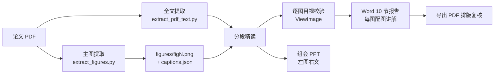

# bio-literature-review

一个面向**生物信息学 / 基因组学 / 肿瘤学**文献的精读 Skill：给它一篇论文 PDF，它会**把每张主图切出来**，再按 10 节结构生成带图讲解的 Word 精读报告，以及组会分享用的 PPT。

不是"帮我把论文总结一下"。它要回答的是：**作者为什么这样设计分析、这个结果证明了什么、方法能不能复现。**

---

## 为什么做这个

读生信论文的难点从来不在摘要，而在三件事：

1. **图看不懂** —— 一张 Figure 有 6 个 panel，图注三行字，真正的方法细节藏在 Methods 里；
2. **方法挖不深** —— "作者用 XX 做了 YY 分析"是废话，要的是软件名、版本、参数阈值、输入输出；
3. **图抓不出来** —— PDF 里的图跨栏、图注在下一页、页眉是整条色块，截图永远缺一块。

通用大模型能做完第 1、2 件，但第 3 件（从 PDF 里**精确**切出主图）一直是个工程问题。这个仓库主要解决的就是它。

---

## 特性

| 能力 | 实现 |
|---|---|
| **主图自动提取** | PyMuPDF 定位图注 → 以图形元素（位图 + 矢量）包围盒定图区 → 吸附图内文字（轴标签、panel 字母、risk table）→ 300 dpi 渲染 PNG |
| **版式自适应** | 图注在图下 / 图注在栏顶图在旁栏 / 图注在图上方 / **图注在下一页**（Cell Press 版式）；自动过滤期刊彩条页眉 |
| **防正文误吸** | 吸附文字块时限制行数与位置，避免把图下方的正文段落吞进图片 |
| **10 节 Word 报告** | 基本信息 → 背景 → 目的 → 样本设计 → 生信流程 → 名词解析 → **逐图讲解** → 创新点 → 局限性 → 总结 |
| **逐图四段式** | 每张图：研究问题 → 方法（软件/算法/参数）→ 关键结果（含统计量）→ 解读 |
| **组会 PPT** | 13 页左右，每个 Figure 一页左图右文，Nature/Cell 风格 |

---

## 工作流程



关键设计：**提图和读文是并行的**。图先切出来，精读时对照 PNG 看 panel 结构，而不是靠文字猜图长什么样——这样 Figure 讲解才不会写空。

---

## 快速开始

### 依赖

```bash
pip install pymupdf pdfplumber python-docx python-pptx pillow
```

> 国内网络建议走镜像：`pip install pymupdf -i https://mirrors.cloud.tencent.com/pypi/simple`
>
> `pymupdf` 必需（提图靠它做坐标级版面分析）。注意新版导入是 `import pymupdf as fitz`。

### 用法

```bash
# 1. 提取全文
python scripts/extract_pdf_text.py paper.pdf full_text.txt

# 2. 提取主图（默认 300 dpi）
python scripts/extract_figures.py paper.pdf --out ./figures --dpi 300

# Cell Press / Cell Genomics 版式加页眉阈值
python scripts/extract_figures.py paper.pdf --out ./figures --dpi 300 --header-frac 0.13

# 需要 Extended Data / Supplementary 图
python scripts/extract_figures.py paper.pdf --out ./figures --include-ed
```

产出：

```
figures/
  fig1.png ... figN.png      # 主图，300 dpi
  captions.json              # 图号 → 图注原文 / 页码 / bbox / 提取状态
```

### 生成报告

把 `scripts/generate_word_report.py` 复制到论文目录，替换内容块后运行：

```bash
python generate_word_report.py "Nature_2025_Topic_LiteratureReview.docx"
```

---

## 主图提取是怎么做的

大部分"从 PDF 提图"失败在同一个地方：**图的边界不是图片的边界**。一张科研主图往往由几十个矢量图元 + 若干位图 + 一堆文字块（轴刻度、panel 字母、`Number at risk` 行）拼成，`get_images()` 只能拿到其中一部分。

所以这里的做法是：

1. **找图注** —— 扫文本块，首行匹配 `Fig. 1 |` / `Figure 1.` / `图1`，且长度像一句话（≥30 字符，排除正文引用）；
2. **判断图注与图的相对位置** —— 图注上方有图形 → `above`；图形在图注旁栏 → `beside`；图注上方无图形 → **回上一页取图**（`prev-page`，Cell Press "legend continued on next page"）；
3. **定图区** —— 取所有图形元素的包围盒并集，过滤页眉彩条与整页细横线；
4. **吸收图内文字** —— 只吸收"紧凑"（短高或窄宽、≤4 行）且与图区水平重叠或紧邻的文字块；`beside` 模式下要求文字块起始于图形底边之上，防止吞进正文；
5. **渲染** —— 按 bbox `clip` 出 PNG。

已实测通过的版式：

| 期刊 | 图数 | 结果 |
|---|---|---|
| Nature（TRACERx 肺癌） | 4/4 | 整页大图正常 |
| Nature（NSCLC 转移） | 4/4 | Fig4 图注在右栏顶部 → beside |
| Nature（拷贝数多样性） | 6/6 | 含 `Number at risk` 表格行 |
| Cancer Cell（南京队列） | 5/5 | 图注在下一页 → prev-page；彩条页眉 |
| Cell Genomics（泛基因组） | 5/5 | beside + 正文防误吸 |

**提完必须看一眼。** 脚本会把 `status` 写进 `captions.json`（`above` / `beside` / `prev-page` / `fallback`），看到 `fallback` 就要人工核对——宁可重渲染一个 bbox，也不要往报告里贴一张缺 panel 的图。

---

## Word 报告结构

10 节固定骨架，详见 [`references/word_structure.md`](references/word_structure.md)：

| # | 章节 | 要求 |
|---|---|---|
| 1 | 文献基本信息 | 期刊 / 年份 / DOI / 通讯作者 |
| 2 | 研究背景 | 领域现状与未解决问题，不要复述摘要 |
| 3 | 研究目的 | 本文要回答的具体科学问题 |
| 4 | 样本与实验设计 | 队列规模、测序平台、数据量、对照设置 |
| 5 | 生信分析流程解析 | 软件名 + 版本 + 参数 + 输入输出，能照着复现 |
| 6 | 重点专业名词解析 | 保留英文缩写，解释技术原理而非字面翻译 |
| 7 | 主要研究内容 | **每张主图：嵌入 PNG + 图注 + 四段式讲解** |
| 8 | 研究创新点 | 方法学与生物学两层，说清"新在哪" |
| 9 | 局限性分析 | 作者自述 + 你自己看出的问题（分开写） |
| 10 | 总结 | 结论与对自身工作的启示 |

排版上踩过的坑都固化进脚本了：

- 表格表头必须**显式填深色底**，否则白字在 Word 里看不见；
- 图片按「宽 15.5 cm、最高 18.5 cm」等比缩放，否则竖长的多 panel Manhattan 图会溢出页面被裁掉；
- 跨页表格给表头加 `w:tblHeader`、每行加 `w:cantSplit`，否则后半张表没有表头。

---

## 目录结构

```
.
├── SKILL.md                          # Skill 主文档（触发条件、工作流）
├── references/
│   ├── word_structure.md             # 10 节报告结构规范 + 逐图块格式
│   ├── ppt_structure.md              # PPT 页面结构规范
│   ├── interpretation_principles.md  # 解读原则（保留术语、深度优先、不编造）
│   └── popular_science_style.md      # 科普文章写法（可选分支）
└── scripts/
    ├── extract_pdf_text.py           # pdfplumber 全文提取
    ├── extract_figures.py            # PyMuPDF 主图提取（本仓库核心）
    ├── generate_word_report.py       # Word 报告模板（含 add_figure_block）
    └── generate_ppt_slides.py        # PPT 模板（含图页左图右文）
```

---

## 三条不可破的规矩

1. **不编造数据。** 论文里没有的数字不写，不确定的地方标「需确认」。
2. **术语保留英文缩写。** `SCNA`、`CCF`、`MILP` 就是 `SCNA`、`CCF`、`MILP`，不硬翻。
3. **图要亲眼看过。** 提取脚本再聪明也会遇到极端版式，贴一张坏图比不贴更糟。

---

## 说明

- 本仓库只包含 Skill 本身（文档 + 脚本），**不包含任何论文 PDF、提取的图片或生成的报告**。请只处理你有权访问的文献，产出的报告与图片不要随仓库分发。
- 脚本用 PyMuPDF 渲染 PDF 页面区域，属于对你自己合法持有文档的本地处理，不改变原始文件。
- 在 Nature / Cancer Cell / Cell Genomics 的 PDF 上做过实测，其他版式（尤其双栏排版不规则的预印本、扫描版 PDF）可能需要调整 `--header-frac`、`--gap` 等参数。扫描版 PDF 没有文本层，图注定位不出来——那种情况需要先 OCR。

## License

MIT，见 [LICENSE](LICENSE)。
